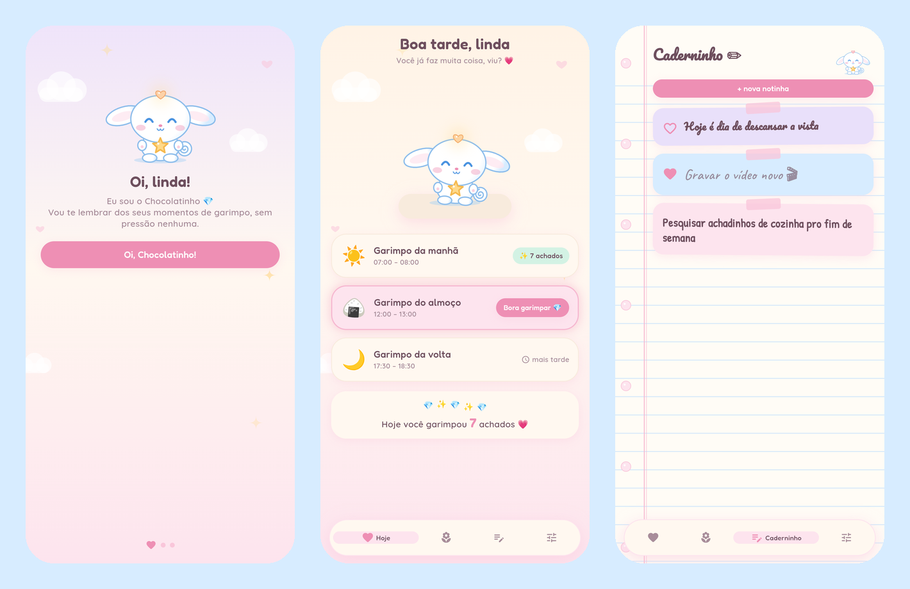
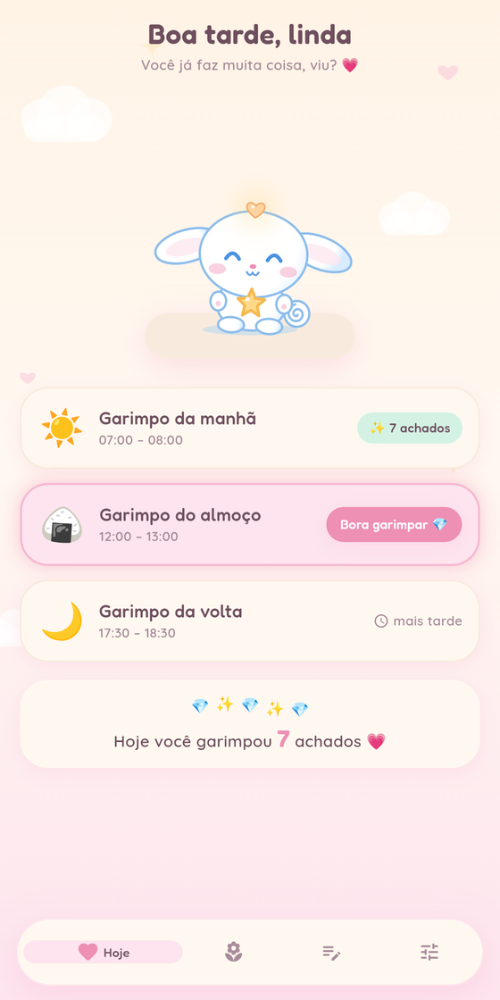
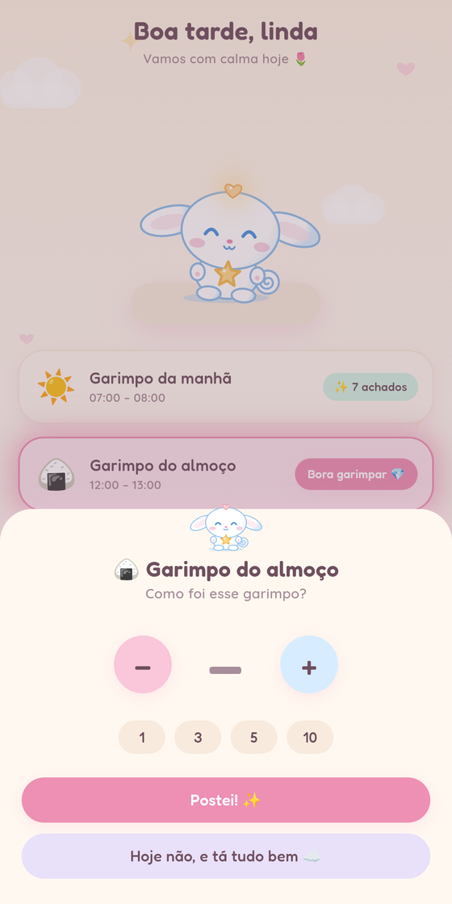
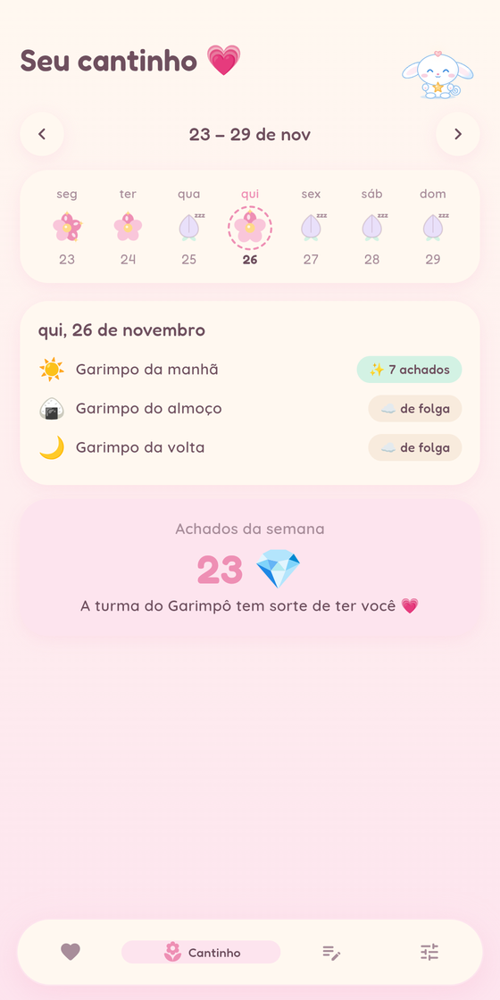
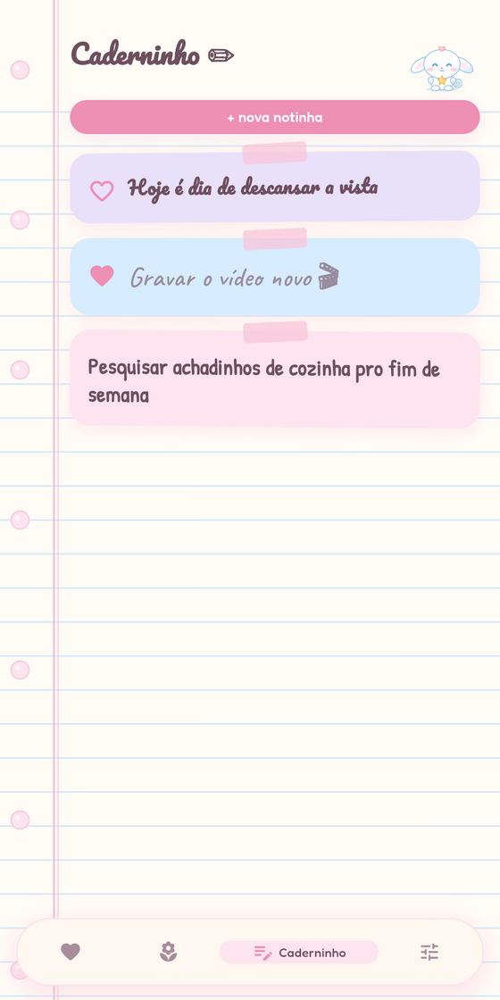
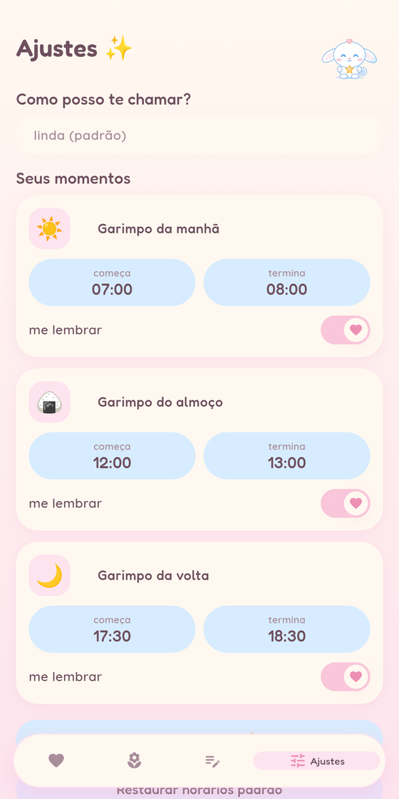

<div align="center">



# 💎 Pepita

**Um cantinho de garimpo que lembra com carinho — e nunca cobra.**


</div>

---

## 💗 Por que existe

Minha namorada tem um trabalho CLT e, como renda extra, mantém um grupo de ofertas (o **Garimpô**) no WhatsApp: ela procura promoções, troca pelo link de afiliado dela e posta no grupo, tudo manualmente.

Eu fiz a **Pepita** — o app, cujo nome vem da pepita de ouro do garimpo — e a mascote é o **Chocolatinho**, um coelhinho de orelhas caídas criado por ela. Juntos eles ajudam com **uma coisa só**: lembrar, com carinho, dos **3 momentos do dia** em que ela pode postar, e deixar ela anotar (se quiser) o que fez.

| Momento | Horário padrão |
|---|---|
| ☀️ Garimpo da manhã | 07:00 – 08:00 |
| 🍙 Garimpo do almoço | 12:00 – 13:00 |
| 🌙 Garimpo da volta | 17:30 – 18:30 |

Nomes, emojis, horários e lembretes são todos editáveis nos Ajustes.

## 🌷 Regra de ouro

> Este app **não cobra**. É renda extra e o lazer vem primeiro.

- Sem streak, sequência, meta, porcentagem ou ranking.
- Sem vermelho e sem texto de culpa (nada de "atrasado", "pendente" ou "você esqueceu").
- Dia sem registro é **dia de descanso**, sempre mostrado de forma positiva (flor fechadinha, dormindo).
- Registrar é opcional. Quantidade também.
- No máximo **1 notificação por momento** — e nenhuma de "você ainda não postou".
- Entre funcionalidade e fofura, **a fofura ganha**.

Isso não é só intenção: há [testes automáticos](test/linguagem_gentil_test.dart) que falham se qualquer frase, texto da interface ou cor da paleta violar essas regras.

## ✨ Um passeio pelo app

<table>
  <tr>
    <td align="center" width="20%"><br><b>Hoje</b><br><sub>Saudação, o Chocolatinho e os 3 momentos. O momento "agora" brilha suavemente.</sub></td>
    <td align="center" width="20%"><br><b>Registro</b><br><sub>Contador opcional (começa vazio!) e dois botões igualmente gentis.</sub></td>
    <td align="center" width="20%"><br><b>Cantinho</b><br><sub>A semana em florzinhas. Dia sem postagem = botão de flor descansando.</sub></td>
    <td align="center" width="20%"><br><b>Caderninho</b><br><sub>Notinhas numa folha de caderno, com fontes fofinhas e papéis coloridos.</sub></td>
    <td align="center" width="20%"><br><b>Ajustes</b><br><sub>Nome, horários, emojis e lembretes com switch em formato de coração.</sub></td>
  </tr>
</table>

<sub>Os prints são do app rodando com dados de exemplo.</sub>

### 🐰 O Chocolatinho

A mascote é **autoral** (criação dela), redesenhada inteira em `CustomPainter` (vetorial, sem imagens), com orelhas caídas que balançam, rabinho enrolado e uma estrelinha dourada. Tem cinco estados que se misturam sem cortes secos:

| Estado | Quando | O que faz |
|---|---|---|
| `tranquila` | padrão | respira, pisca a cada 3–6 s, a estrelinha cintila |
| `animada` | algum momento está rolando | balança de lado a lado, orelhinhas levantam, coração brilha |
| `comemorando` | depois de "Postei!" | pulinho com orelhas ao vento, partículas, coração aceso, número "voando" até o rodapé |
| `aconchegada` | descansou / noite | olhinhos fechados, orelhas caídas, abraça a estrelinha, "zzz" |
| `curiosa` | toque longo / ajuste a corrigir | uma orelha em pé, "?" |

O desenho é separado do comportamento (`PosePepita` → `PepitaPainter`), então dá para trocar por uma arte feita à mão sem mexer no resto do app.

### Outros detalhes fofos

- Fundo com nuvenzinhas, corações e estrelinhas flutuando; o céu muda de tom conforme a hora do dia.
- Toda interação responde: escala ao toque com mola, brilho e haptic leve.
- Respeita "reduzir animações" do sistema (movimento forte vira fade simples).
- **Caderninho:** aba de anotações livres numa folha de caderno fofinha, com 4 fontes de letrinha e 6 papéis. A "bolinha de feitinho" é opcional e não conta nada.
- Fontes **Fredoka** e **Quicksand** (mais as letrinhas do Caderninho) empacotadas — funciona 100% offline.
- Ícone do app, imagem grande da notificação e silhueta da notificação gerados a partir do próprio desenho do Chocolatinho ([`tool/gerar_arte_test.dart`](tool/gerar_arte_test.dart)).

## 🔔 Notificações

- Uma por momento, no horário de início, repetindo todo dia (fuso `America/Sao_Paulo`).
- `AndroidScheduleMode.inexactAllowWhileIdle`: não precisa de permissão de alarme exato.
- Sobrevivem a reinício do celular (receivers de boot declarados no manifest).
- Título e texto sorteados de bancos de frases carinhosas, renovados a cada abertura do app.
- Tocar na notificação abre direto a sheet de registro daquele momento.
- Android 13+: a permissão é pedida na 3ª tela de boas-vindas, com uma explicação antes. Se for negada, o app segue funcionando normalmente.

## 🛠️ Stack

- **Flutter** (Dart 3, Material 3) — Android primeiro; Windows depois, a partir do mesmo código
- [`flutter_local_notifications`](https://pub.dev/packages/flutter_local_notifications) + [`timezone`](https://pub.dev/packages/timezone)
- [`shared_preferences`](https://pub.dev/packages/shared_preferences) — tudo local, sem backend, sem login, sem internet
- Animações com o que já vem no Flutter (`AnimationController`, `Ticker`, `CustomPainter`, `TweenAnimationBuilder`) — nenhum pacote de animação extra

## 🗂️ Estrutura

```
lib/
  main.dart            # inicialização + abas + onboarding
  theme.dart           # paleta, fontes, sombras e raios (única fonte de cores)
  models.dart          # Momento, Registro e helpers de data
  store.dart           # ChangeNotifier + shared_preferences
  notifications.dart   # agendar/cancelar/testar lembretes
  frases.dart          # bancos de frases carinhosas
  screens/             # hoje, cantinho, caderninho, ajustes, onboarding
  widgets/             # pepita, card de momento, sheet, flores, partículas, fundo…
test/                  # linguagem gentil, modelos, store e fluxo do app
tool/                  # gerador da arte do Android
docs/SPEC.md           # especificação completa
```

## 🚀 Como rodar

Pré-requisitos: Flutter (stable), JDK 17 e Android SDK com a plataforma 37.

```bash
flutter pub get
flutter analyze
flutter test
flutter run                       # num celular/emulador Android
flutter build apk --release       # gera build/app/outputs/flutter-apk/app-release.apk
```

Para regenerar o ícone e as imagens da notificação depois de mexer no desenho do Chocolatinho:

```bash
flutter test tool/gerar_arte_test.dart
```

> O APK de release está assinado com a chave de debug, o que basta para instalar direto no celular. Para publicar numa loja seria preciso configurar uma keystore própria.

## ✅ Estado do projeto

Todas as telas, animações, notificações e testes automáticos estão prontos (`flutter analyze` limpo e 21 testes passando). Ainda falta a verificação num **aparelho físico**: confirmar a entrega dos lembretes nos horários, depois de reiniciar o celular, e a abertura da sheet certa ao tocar na notificação.

## 📚 Documentação

| Arquivo | Conteúdo |
|---|---|
| [`docs/SPEC.md`](docs/SPEC.md) | Especificação completa: telas, notificações, visual, frases, dados e critérios de aceite |
| [`CLAUDE.md`](CLAUDE.md) | Diretrizes do projeto para o assistente de código (regra de ouro, stack, convenções, armadilhas do Android) |

## 🚫 Fora de escopo

Bot de promoções, automação de link de afiliado, vídeos, carrosséis, login e sincronização na nuvem.

## 📄 Licença

Código sob licença [MIT](LICENSE). As fontes (Fredoka, Quicksand, Patrick Hand, Pacifico, Caveat e Sniglet) são distribuídas sob a SIL Open Font License; as licenças estão em [`assets/fonts`](assets/fonts).

---

<div align="center">

Feito com 💗 pelo Lucas, para a minha namorada.

</div>
